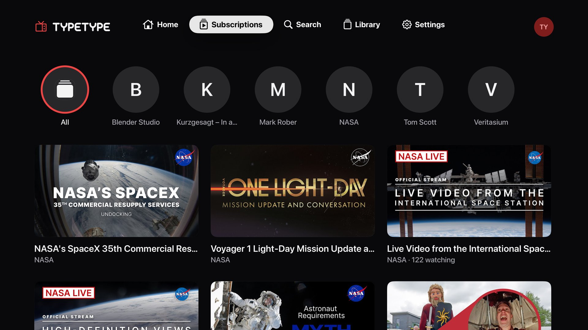
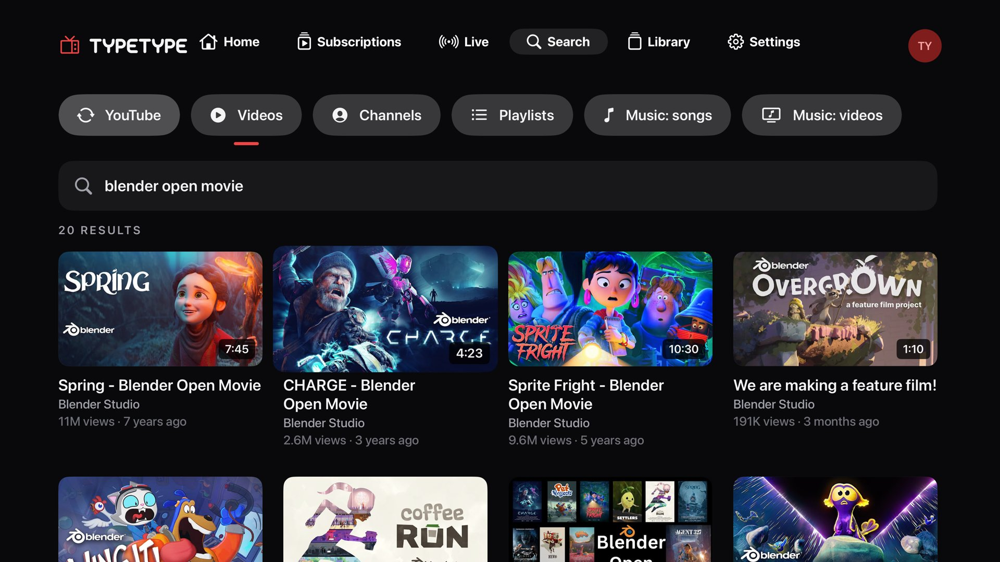
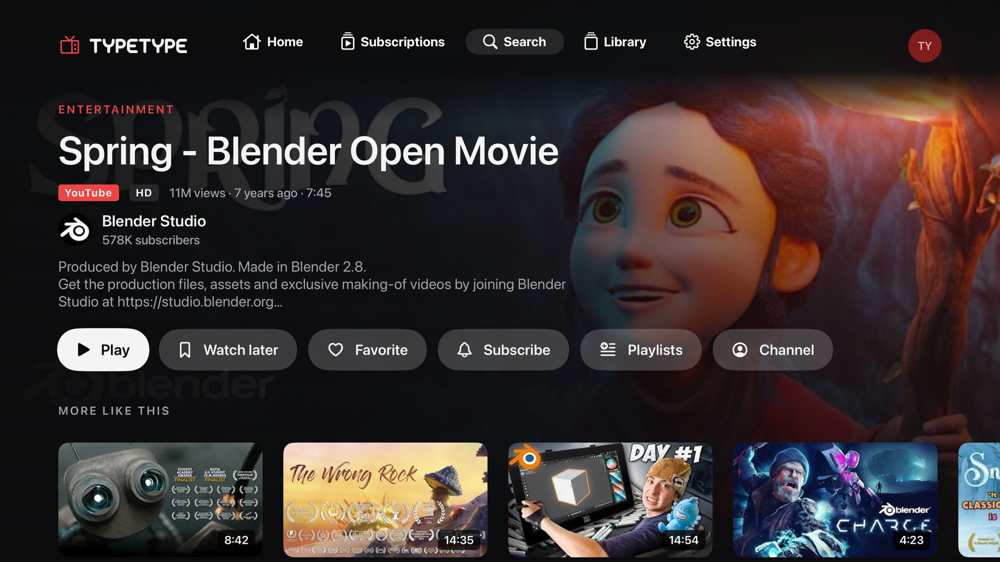
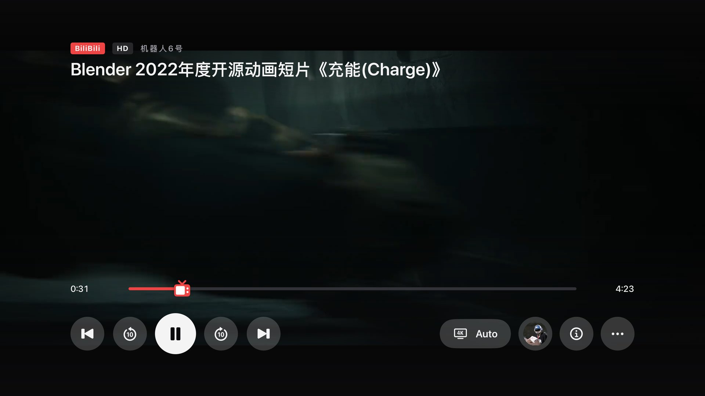
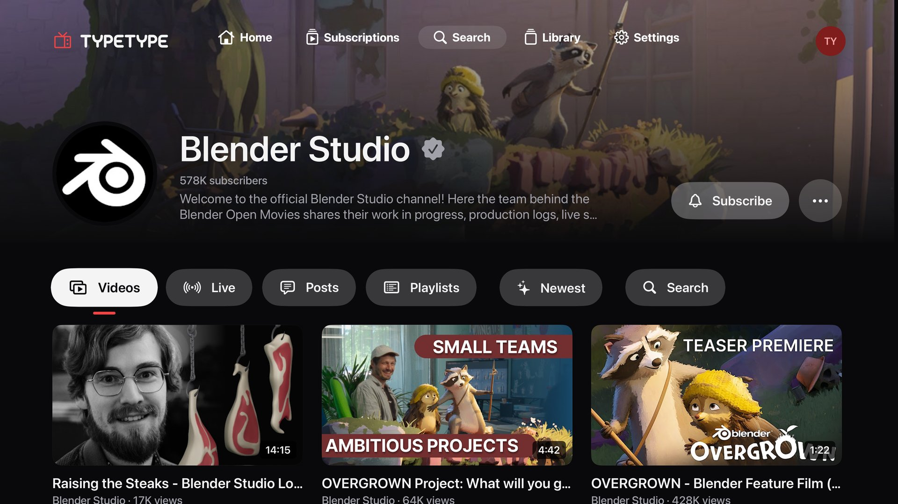
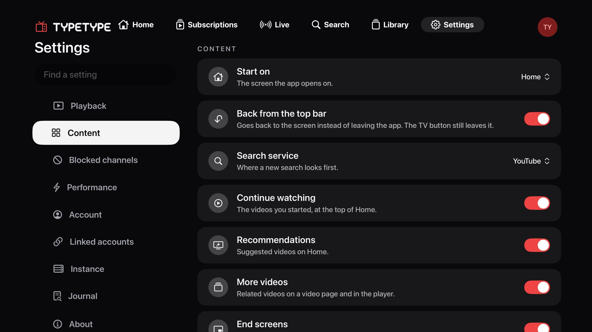

<!-- markdownlint-disable MD033 MD041 -->

<div align="center">
  
  <h1>TypeType for Apple TV</h1>
  <p>Native Apple TV client for TypeType.</p>
</div>

You want to know the current position of TypeType about AI ? Go check [this](https://github.com/TypeType-Video/TypeType/blob/dev/AI_TRANSPARENCY.md).

<div align="center">

[](LICENSE)
[](project.yml)
[](https://github.com/TypeType-Video/TypeType)

[User guide](https://typetype-video.github.io/Docs-TypeType/guide/) · [Download](https://github.com/TypeType-Video/TypeType-tvOS/releases) · [Report a problem](https://github.com/TypeType-Video/TypeType-tvOS/issues)

</div>

TypeType for Apple TV is the living-room client for
[TypeType](https://github.com/TypeType-Video/TypeType), a self-hosted video
platform. It runs on Apple TV with tvOS 17 or newer and plays YouTube,
BiliBili and NicoNico with a native player made for the Siri Remote, without a
WebView.

The app uses the TypeType Server selected during setup for extraction, playback
sessions, recommendations, and synchronization. Your subscriptions, history,
playlists, and settings are the same as on the web and on your phone.

> [!NOTE]
> The Apple TV app is in early access: releases are marked as pre-releases while
> it matures.

## Screenshots

| Subscriptions | Search |
| --- | --- |
|  |  |

| Video page | Player |
| --- | --- |
|  |  |

| Channel | Settings |
| --- | --- |
|  |  |

## Features

- Browse Home, Subscriptions, Search, and Library from the top bar, with a
  featured video and a short preview when you rest on a card.
- Sign in by scanning a QR code with your phone, with a password, or continue
  as a guest when the instance allows it.
- Search YouTube, BiliBili, and NicoNico with the Apple TV keyboard, including
  dictation and typing from an iPhone.
- Browse and watch Twitch lives, past broadcasts, and clips in the Live tab when
  your instance enables Twitch, and go back in a live from the player.
- Read the Twitch chat beside the picture with its emotes and badges, vote in
  polls and write with a linked account, link it with a code or a QR code, and
  follow channels.
- Choose the home page algorithm, and see server restarts, updates, and outages.
- Watch with a player built for the remote: hold ±10 seconds to keep skipping,
  scrub on the clickpad with frame previews, chapters, captions, audio tracks,
  quality, and audio only.
- Skip sponsors with SponsorBlock, see the next video before it starts, and
  follow bullet comments on BiliBili and NicoNico.
- Read comments with their replies, images, and creator voice replies, and
  follow the chat of YouTube lives next to the picture.
- Open the creator's end screen cards at the end of a YouTube video.
- Visit channels with their videos, lives, posts, playlists, and courses, and
  search inside a channel.
- Resume videos, and keep your history, favorites, Watch Later, and playlists.
- Link your YouTube and BiliBili accounts, and change your instance settings
  from the TV.
- Find any setting by typing its name in Settings.
- Use the app in English or French.

## Install

1. Download the IPA from the
   [Releases](https://github.com/TypeType-Video/TypeType-tvOS/releases).
2. Verify it with the matching SHA-256 file if desired.
3. The IPA is unsigned: sign it with your own Apple ID and install it on your
   Apple TV, or build and run the `TypeTypeTV` scheme from Xcode. With a free
   Apple ID, the app has to be signed again every 7 days.
4. Enter your TypeType instance address, then sign in or continue as a guest
   when supported.

> [!NOTE]
> TypeType for Apple TV is a client for
> [TypeType-Server](https://github.com/TypeType-Video/TypeType-Server). You need
> access to a compatible TypeType instance. If you want to host one, start with
> the [self-hosting guide](https://typetype-video.github.io/Docs-TypeType/self-hosting/introduction).

## Build from source

You need Xcode and [XcodeGen](https://github.com/yonaskolb/XcodeGen).

```sh
xcodegen generate
open TypeTypeIOS.xcodeproj
```

Choose the `TypeTypeTV` scheme and an Apple TV simulator or device. The app
shares its networking, accounts, and playback core with
[TypeType iOS](https://github.com/TypeType-Video/TypeType-IOS), in the
`TypeTypeIOS` folder.

Run the unit tests before opening a pull request against `dev`:

```sh
xcodebuild -project TypeTypeIOS.xcodeproj -scheme TypeTypeIOSUnit \
  -destination "platform=iOS Simulator,name=iPhone 17" test
```

GitHub Actions runs the same unit tests and an unsigned build of the Apple TV
app on every push and pull request.

## Help and feedback

- Read the [TypeType user guide](https://typetype-video.github.io/Docs-TypeType/guide/).
- Check the [Apple TV Releases](https://github.com/TypeType-Video/TypeType-tvOS/releases).
- Report bugs and request features in the
  [Apple TV issue tracker](https://github.com/TypeType-Video/TypeType-tvOS/issues).

When reporting a problem, include the tvOS version, app version, TypeType
Server version, and the action that failed. **Settings > Journal > Send the
journal** sends the app's journal to your instance as a bug report.

## License

TypeType for Apple TV is licensed under the
[Mozilla Public License 2.0](LICENSE).

Copyright © 2026 Priveetee and TypeType contributors.

The screenshots show public YouTube and BiliBili videos, taken on the Apple TV
simulator with a test account on a test instance.
